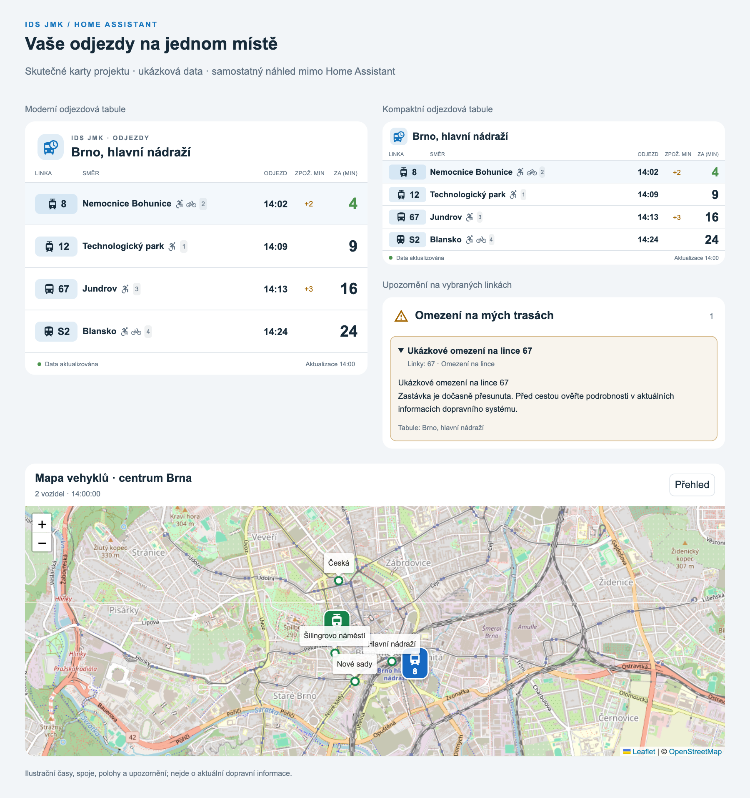
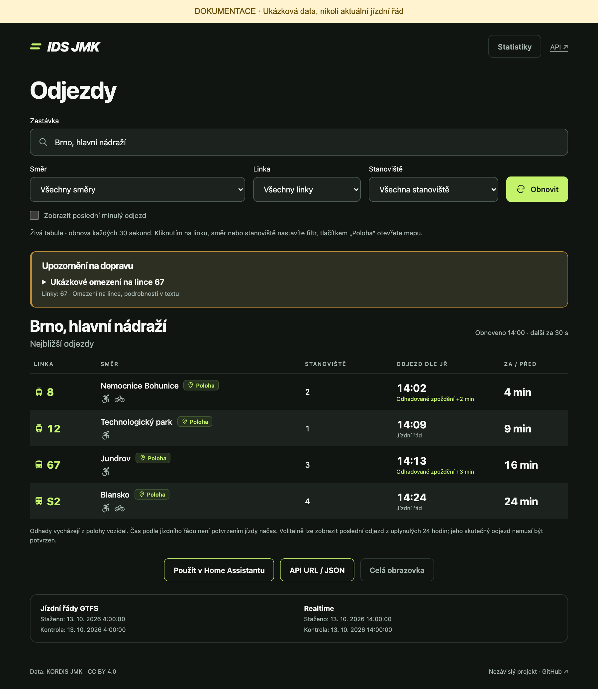

# IDS JMK

**Odjezdy, upozornění a mapa vozidel IDS JMK ve Vašem Home Assistantu.** Vlastní API server zpracovává jízdní řády a volitelná realtime data. Stejná data můžete zobrazit i ve webovém prohlížeči nebo použít ve vlastním displeji či aplikaci.

## Obsah

- [Pro uživatele Home Assistantu](#pro-uživatele-home-assistantu)
- [Pro vývojáře](#pro-vývojáře)
- [Jak spolu součásti fungují](#jak-spolu-součásti-fungují)
- [Zdroje a podmínky dat](#zdroje-a-podmínky-dat)

## Pro uživatele Home Assistantu

Pro běžné použití nepotřebujete programovat ani psát YAML. Nastavíte zdroj dat, vyberete zastávku a přidáte kartu přes vizuální editor dashboardu.

*Skutečný kód HA karet v samostatném náhledu, nikoli snímek celé instalace Home Assistantu. Časy, spoje, polohy a omezení jsou ilustrační. [Původ obrázků](docs/screenshots/README.md).*

| Chcete… | Pokračujte zde |
| --- | --- |
| Začít od nuly | [Průvodce instalací pro uživatele](docs/home-assistant.md#než-začnete) |
| Zobrazit odjezdy své zastávky | [Přidání integrace a tabule](docs/home-assistant.md#přidání-serveru-a-první-tabule) |
| Vybrat vzhled a pochopit údaje | [Odjezdová karta](docs/home-assistant.md#vlastní-karta-ids-jmk) |
| Vidět výluky a omezení | [Karta upozornění](docs/home-assistant.md#karta-upozornění-z-více-tabulí) |
| Sledovat vozidla na mapě | [Mapová karta](docs/home-assistant.md#mapa-vozidel) |
| Vyřešit prázdnou kartu nebo chybu | [Časté potíže](docs/home-assistant.md#časté-potíže) |

**[Otevřít celý návod pro Home Assistant →](docs/home-assistant.md)**

Parser můžete provozovat jako aplikaci přímo v **HA OS** nebo na vlastním Docker serveru. Ve stejném repozitáři je vydaná varianta **IDS JMK Parser** a automaticky sestavovaná **IDS JMK Parser (Dev)**. Dev se v obchodě objeví po prvním úspěšném vývojovém sestavení s podporou kanálů. Instalace a běh verze 0.1.4 byly potvrzeny uživatelem na skutečném HA OS; záloha/obnova a nároky na RPi zatím nejsou ověřeny. Integraci a karty přidáte samostatně přes vlastní repozitář HACS nebo ručně. Podrobně Vás provede uživatelský návod.

## Pro vývojáře

API vrací JSON pro odjezdové tabule, polohy, upozornění a statistiky. Web i integrace HA používají stejné API. Web je volitelný a má samostatný Docker obraz.

| Téma | Dokumentace |
| --- | --- |
| Architektura, lokální spuštění a testy | [Vývojářský průvodce](docs/development.md) |
| Endpointy, časy, odhady a datové kontrakty | [Reference API](docs/api.md) |
| Docker, Portainer, reverse proxy a proměnné | [Instalace a provoz serveru](docs/deployment.md) |
| Vydávání a distribuční balíčky | [Vydávání verzí](docs/releases.md) |
| Ukázková data a obnova screenshotů | [Obrázky dokumentace](docs/screenshots/README.md) |

*Skutečný web s ukázkovými odpověďmi API. Filtry určují odjezdy; tlačítko **API URL / JSON** vytvoří adresu pro vlastní aplikaci. Web není nutný pro provoz HA karet.*

**[Otevřít vývojářský průvodce →](docs/development.md)**

Aktuální verze v repozitáři je **0.1.6**. Balíčky integrace a instalační Compose soubory najdete ve [vydáních na GitHubu](https://github.com/CooLajz/IDS-JMK/releases). Obrazy API, webu a parseru pro HA se sestavují pro Linux AMD64 a ARM64.

## Jak spolu součásti fungují

| Součást | Co dělá | Kdy ji potřebujete |
| --- | --- | --- |
| Parser / API server | Stahuje a zpracovává data KORDIS, poskytuje odjezdy a další údaje | Vždy; stačí jeden společný zdroj pro více klientů |
| Integrace Home Assistantu | Propojuje HA s API, vytváří tabule a diagnostické senzory | Pro použití vlastních HA karet |
| Dashboardové karty | Zobrazují odjezdy, upozornění a mapu vybraných linek | Přidejte si požadované karty do dashboardu |
| Web | Vyhledává zastávky, zobrazuje tabuli a detail spoje, sestavuje API URL | Volitelně, i bez Home Assistantu |

**Realtime je ve výchozím nastavení vypnutý.** Plánované odjezdy fungují i bez něj. Pro zpoždění, vozidla a upozornění zapněte realtime v parseru. Chybějící odhad neznamená nulové zpoždění; mapa zobrazuje jen dostupné čerstvé polohy. [Jak číst údaje](docs/home-assistant.md#jak-číst-odjezdy).

## Zdroje a podmínky dat

Aplikace stahuje **přímo z KORDIS JMK**:

- [GTFS jízdní řády](https://kordis-jmk.cz/gtfs/gtfs.zip)
- [GTFS Realtime](https://kordis-jmk.cz/gtfs/gtfsReal.dat)

KORDIS na [oficiální stránce otevřených dat](https://www.idsjmk.cz/a/kontakty.html) uvádí pro statické GTFS i dynamické GTFS Realtime licenci **[CC BY 4.0](https://creativecommons.org/licenses/by/4.0/)** (ověřeno 11. 10. 2026). Při dalším použití uveďte původ dat a licenci a rozlišujte vlastní úpravy či odhady. Podrobnosti a doporučené uvedení zdroje jsou v [docs/data-sources.md](docs/data-sources.md).

Týdenní obnova zmíněná na [portálu Brna](https://data.brno.cz/datasets/379d2e9a7907460c8ca7fda1f3e84328/about) se týká jeho kopie ke stažení; není intervalem aktualizace přímých zdrojů KORDIS používaných aplikací.

Mapový podklad používá OpenStreetMap a načítá se při zobrazení mapy v prohlížeči. Pro větší veřejné instalace zvolte vlastní vhodný mapový server v souladu s [podmínkami OSM dlaždic](https://operations.osmfoundation.org/policies/tiles/).

Projekt je nezávislý a není oficiální aplikací KORDIS JMK. Vlastní kód je dostupný pod [licencí MIT](LICENSE). Licence kódu nemění licenci dopravních dat ani knihoven třetích stran.
