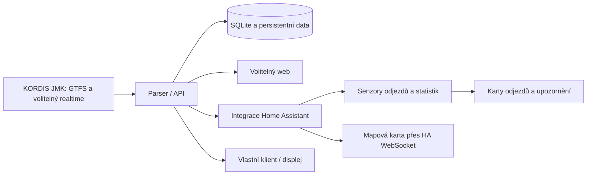

# Pro vývojáře

[← Rozcestník](../README.md) · [API](api.md) · [Provoz serveru](deployment.md)

## Obsah

- [Architektura a tok dat](#architektura-a-tok-dat)
- [Místní spuštění pro vývoj](#místní-spuštění-pro-vývoj)
- [Orientace v repozitáři](#orientace-v-repozitáři)
- [První klient API](#první-klient-api)
- [Ověření](#ověření)
- [Úpravy dokumentace a obrázků](#úpravy-dokumentace-a-obrázků)

## Architektura a tok dat



Parser stahuje společná zdrojová data a API z nich obsluhuje všechny klienty. Web ani HA znovu neimportují GTFS. Odjezdová a upozorňovací karta čtou atributy senzorů; mapa žádá přes HA WebSocket o filtrované polohy a zastávky, nevytváří entity pro jednotlivá vozidla. Mapový podklad se načítá z OpenStreetMap v prohlížeči.

API funguje samostatně. Jeden datový svazek patří jedné instanci API s jedním procesem Uvicornu. Nový GTFS se importuje odděleně a teprve po úspěchu nahradí původní databázi. Časy, kalendář provozních dnů a čerstvost realtime mají význam pro správnost klienta: [podrobnosti API](api.md).

## Místní spuštění pro vývoj

Požadavky: Python 3.13, [uv](https://docs.astral.sh/uv/) a Node.js 22.12+.

```sh
uv sync --frozen
uv run uvicorn api.main:app --host 127.0.0.1 --port 8000
```

V druhém terminálu:

```sh
cd web
npm ci
npm run dev
```

Web: [http://127.0.0.1:5173](http://127.0.0.1:5173). API dokumentace: [http://127.0.0.1:8000/docs](http://127.0.0.1:8000/docs).

První start automaticky stáhne jízdní řády a vytvoří databázi v `data/`. Během importu API vrací stav 503 s vysvětlením; web počká a připojí se automaticky.

## Orientace v repozitáři

| Umístění | Odpovědnost |
| --- | --- |
| `api/main.py`, `api/models.py` | HTTP endpointy a datové modely |
| `api/gtfs.py`, `api/realtime.py`, `api/vehicle_map.py` | Jízdní řády, odhady a polohy |
| `api/downloads.py`, `api/statistics.py` | Obnova zdrojů a statistiky |
| `web/` | Samostatný web, Vite a nginx proxy |
| `custom_components/ids_jmk/` | HA konfigurace, klient, senzory a WebSocket |
| `custom_components/ids_jmk/www/` | Tři vlastní dashboardové karty a Leaflet |
| `home-assistant/ids_jmk/` | Společná šablona, spouštění a vydaná aplikace HA OS |
| `home-assistant/ids_jmk_dev/` | Samostatná vývojová varianta v obchodě HA |
| `scripts/ha_channels.py` | Publikování nabídky verzí po dokončení sestavení |
| `tests/` | Python testy a JavaScript testy karet |
| `docs/preview/`, `docs/screenshots/` | Ukázková data, náhled a obrázky dokumentace |

## První klient API

1. Ověřte `GET /health/ready`; 503 během prvního importu znamená přípravu dat.
2. Vyhledejte zastávku a z odpovědi převezměte řetězcové ID.
3. Načtěte detail zastávky pro stanoviště, linky a směry.
4. Vyžádejte odjezdy. `departure_time` již obsahuje dostupný odhad; zpoždění k němu znovu nepřičítejte.

```sh
curl --fail 'http://127.0.0.1:8000/api/v1/stops?query=nadrazi&limit=5'
# ID nahraďte skutečným identifikátorem z odpovědi, v URL jej zakódujte.
curl --fail 'http://127.0.0.1:8000/api/v1/stops/ID/departures?limit=6'
```

Ve webu lze stejnou URL sestavit tlačítkem **API URL / JSON** podle aktuálních filtrů. Pro interaktivní zkoušení slouží `/docs`, pro generování klienta `/openapi.json`. [Reference API](api.md) popisuje také vypnutý realtime, upozornění, mapové endpointy a statistiky. Syntetické příklady v dokumentaci nejsou živý jízdní řád.

## Ověření

```sh
uv run pytest -q
uv run ruff check api custom_components tests
node --test tests/*.test.mjs
cd web
npm ci
npm run build
```

Testy používají malé syntetické GTFS archivy, nikoli síťové služby. Pokrývají import, zachování staré databáze, kalendáře a výjimky, časy po půlnoci, změny času, odhady a stáří realtime i odpovědi API.

GitHub Actions ověřují Python testy, web, hassfest, oba Docker obrazy, první import, webovou proxy a zachování identity po restartu. Publikování obrazů je podmíněné úspěchem těchto kontrol. Samostatná testovací instalace byla ověřena za HTTPS reverse proxy; konfigurace a senzor integrace byly ověřeny v izolovaném Home Assistantu 2025.12.5. Vlastní karta byla ověřena i v dashboardu tohoto HA, v grafickém editoru a ve světlém i tmavém motivu na mobilní šířce. Konkrétní prostředí a fyzický displej si ověřte ve své instalaci.

Piktogramy dopravy a vybavení pocházejí z [Material Design Icons od Pictogrammers](https://pictogrammers.com/library/mdi/). Web obsahuje původní SVG cesty z balíčku `@mdi/js` 7.4.47, HA využívá vestavěnou sadu MDI. Licenční oznámení webu je přiloženo v `web/public/THIRD-PARTY-NOTICES.txt`.

## Úpravy dokumentace a obrázků

Uživatelské postupy patří do [návodu HA](home-assistant.md), provozní nastavení do [provozního návodu](deployment.md) a datové kontrakty do [reference API](api.md). Ve veřejných českých textech používejte vykání.

Obrázky vykreslují skutečné zdrojové soubory karet s umělými daty. [Původ a obnova screenshotů](screenshots/README.md) uvádí postup, omezení a ověření. Při změně karet aktualizujte také jejich obrázky. Postup vydávání a CI je popsán v [releases.md](releases.md).
